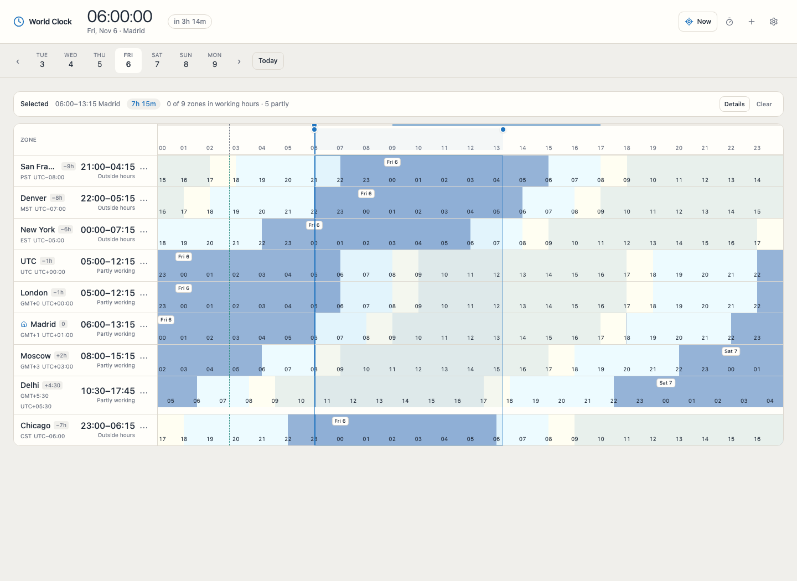

# World Clock

A precise, local-first world clock board for desktop and mobile. One focus
instant drives every row; a range gives exact duration and working-hours
availability without leaving the board.



## Features

- Any number of IANA time zones on one continuous day axis.
- Seven-day strip plus a month calendar with a year/month/date jump for distant dates.
- Focus by click, tap, drag, keyboard, exact wall time, or relative offset.
- Relative badge shows a calendar breakdown, total duration, and comparison date/time.
- Click-drag the board to select a period; duration appears above the board.
- Shift the visible window backward or forward in 6-hour steps; Now resets it and returns to the current time.
- Material-blue day/night shading with a teal focus and range accent.
- Focus-hour highlight at rest; hover follows the cursor, emphasizes the hovered zone, and dims the rest.
- Range duration, wall-clock duration across DST, and per-zone availability.
- Correct DST gaps/overlaps, half-hour and 45-minute offsets, date rollover.
- Add, rename, reorder, remove, and pin zones; choose the home zone.
- Light/dark/system themes, six accents, 12/24-hour, display toggles.
- JSON export/import. Everything stays in the browser.

## Tech stack

Svelte 5 runes, Vite 8, TypeScript 5.9 strict, Tailwind CSS 4, Temporal (native,
with a Safari-only polyfill), Vitest, Testing Library, Playwright, ESLint,
Prettier, pnpm, Node 26. No backend and no runtime UI kit.

## Architecture

Read [`docs/architecture.md`](docs/architecture.md) for the full model. The
short version:

- `src/lib/time/` is pure time math: zones, axis, rows, ranges, formatting.
- `src/lib/state/` holds clock, settings, and board runes.
- `App.svelte` wires stores to prop-driven components.
- Settings persist under the `world-clock` key; the schema validates and repairs
  stored data.
- The visible window is the home-zone day shifted in 6-hour wall-clock steps,
  limited to ±18 hours. A new focus clears the range; range endpoints snap to
  the selection step.

Read [`docs/typography.md`](docs/typography.md) for the type scale and
accessibility rules: 12px minimum metadata, 16px body and mobile inputs, 24px
minimum targets.

## Privacy

There is no backend, account, analytics, or third-party request after the page
loads. Settings and zones live in `localStorage` under `world-clock`. Clearing
site data removes them; export is the backup. Time-zone rules come from the
browser's ICU/IANA data.

## Browser support

Current Chrome, Edge, Firefox, and Safari 16.4+. The layout works from 360 px;
phones use a horizontally scrollable timeline with sticky zone labels.

## Development

Requires Node 26 and pnpm.

```bash
pnpm install
pnpm dev
```

## Quality and pre-push

```bash
pnpm format
pnpm lint
pnpm check        # svelte-check
pnpm test         # unit and component tests
pnpm test:e2e     # desktop, mobile, axe, WebKit polyfill
pnpm build
pnpm verify       # format, lint, check, test, build
```

`pnpm install` sets `core.hooksPath` to `.githooks`. The pre-push hook runs
`pnpm verify`, then Qlty and CodeRabbit when available.

```bash
curl -fsSL https://qlty.sh | sh
brew install coderabbit
coderabbit auth login
```

Missing or unauthenticated tools are skipped. The hook reviews committed changes
against `origin/main` (falling back to `main`) at CodeRabbit gate `major`.
Override the base with `CODERABBIT_BASE_REF`. Bypass once with
`git push --no-verify`.

## CI and deployment

Live at **[alex-just.github.io/world-clock](https://alex-just.github.io/world-clock/)**.

CI runs format check, lint, type check, tests, build, and Chromium end-to-end
tests. The deploy workflow publishes the static `dist/` build to GitHub Pages
from `main`; Pages builds from **GitHub Actions**.

## Structure

```text
src/
  App.svelte          store wiring and layout
  lib/
    actions/          pointer drag, shortcuts, modal behavior
    components/       board, ruler, rows, dialogs, settings
    data/             search-only city aliases
    settings/         schema, storage, mutations, theme
    state/            clock, settings, board runes
    time/             zones, axis, rows, ranges, formatting
  tests/              test setup
docs/
  architecture.md     current design
  screenshot.png
e2e/                  Playwright specs
```

## Agent guide

[`AGENTS.md`](AGENTS.md) documents the invariants, conventions, and verification
workflow for AI agents and maintainers.

## License

MIT. See [LICENSE](LICENSE).

## Acknowledgements

IANA time-zone data via the browser's ICU; [Temporal
polyfill](https://github.com/fullcalendar/temporal-polyfill) for browsers without
native Temporal; [Lucide](https://lucide.dev) icons.
